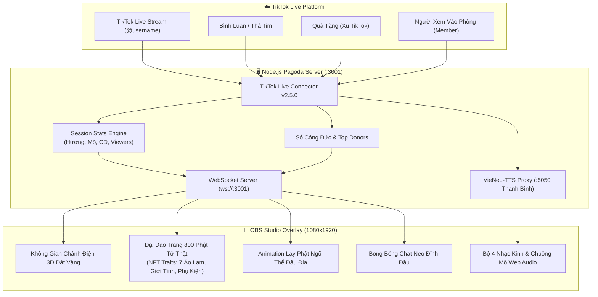

# Vibe Coding Livestream "Chùa Dâng Hương Online" TikTok 3D: Đạo Tràng 800 Phật Tử Thật, Đồ Đi Lễ Kiểu NFT, AI Voice Nam Chuẩn & OBS Tương Tác

*Tác giả: **LongNH** | Chuyên mục: **Vibe Coding & AI Livestream Solutions** | Website: [longnh.com](https://longnh.com)*  
*Mã nguồn mở GitHub: [https://github.com/longhsiaaa/tiktok-pagoda-live](https://github.com/longhsiaaa/tiktok-pagoda-live)*  
*Bản Demo Tương Tác Trực Tiếp: [demo-chua.html](https://longnh.com/demo/tiktok-pagoda-live)*

---

Thời gian gần đây trên nền tảng TikTok, các phòng livestream với chủ đề **"Đi chùa online / Dâng hương cầu an / Rút quẻ đầu tháng"** đang tạo nên cơn sốt bùng nổ, thu hút hàng chục nghìn lượt xem cùng lúc và lượng tương tác quà tặng (gift) khổng lồ. Người xem bình luận niệm Phật, thả tim hay tặng hoa hồng là trên màn hình lập tức xuất hiện làn khói nhang nghi ngút, chuông mõ ngân nga và Phật tử quỳ lạy trang nghiêm.

Sau bài viết chia sẻ về mô hình *Thánh Đường Nhà Thờ Online*, rất nhiều anh em trong cộng đồng lập trình viên và sáng tạo nội dung đã gửi gắm một đề bài thú vị:

> *"Liệu có thể dùng tinh thần **Vibe Coding** để xây dựng một **Ngôi Chùa Việt Nam 3D thuần khiết, tôn nghiêm** với đại đạo tràng chứa tới **800 Phật tử thật**, trang phục đi lễ độc bản kiểu **NFT Traits**, animation lạy Phật **Ngũ Thể Đầu Địa** 3D mượt mà, **box chat mọc đúng đỉnh đầu** từng người xem, giọng đọc sớ AI **VieNeu-TTS Nam chuẩn (Thanh Bình)** và nhạc kinh nền du dương hay không?"*

Hôm nay, LongNH xin chia sẻ toàn bộ kiến trúc kỹ thuật, quy trình **Vibe Coding** thực chiến và toàn bộ mã nguồn mở trọn gói của dự án **`tiktok-pagoda-live`** từ A đến Z!

---

## 1. Những Đột Phá Kỹ Thuật Đỉnh Cao Trong Hệ Thống

Khác với các công cụ livestream chùa đơn giản chỉ dùng ảnh tĩnh hay hiệu ứng co giãn méo mó, hệ thống được thiết kế tỉ mỉ theo chiều sâu văn hóa Phật giáo Việt Nam kết hợp công nghệ web hiện đại:

### 1.1. Đại Đạo Tràng 800 Phật Tử Thật (100% Real Devotees - Zero Fake Bots)
- **Không sinh phật tử giả**: Khi kết nối TikTok Live, hệ thống tự động tắt bỏ toàn bộ bot giả lập, chỉ đón tiếp những người xem thật trên livestream.
- **Sức chứa lên tới 800 Phật tử**: Hai bên cánh tả và cánh hữu của thảm đỏ Chính Đạo có thể hiển thị đồng thời tới 800 Phật tử ngồi thiền trang nghiêm trên bồ đoàn.
- **Cơ chế hàng đợi FIFO (First In, First Out)**: Khi đạo tràng đạt ngưỡng tối đa 800 người, vị Phật tử vào trước nhất (hoặc lâu nhất không tương tác) sẽ nhẹ nhàng tạm ẩn (*fade out*) nhường bồ đoàn phía trên cho người mới bước vào cửa chùa.

### 1.2. Hệ Thống Trait NFT Độc Bản Cho Tín Chủ (Deterministic NFT Generator)
Cùng là trang phục đi lễ chùa truyền thống, nhưng mỗi tài khoản TikTok khi bước vào chùa sẽ sở hữu một diện mạo độc bản duy nhất dựa trên thuật toán băm cố định (*Deterministic Hash*):
- **Giới tính**: Cư sĩ Nam (tóc cắt ngắn, thanh tịnh) hoặc Cư sĩ Nữ (tóc búi cài trâm sen).
- **Bộ 7 Phong Cách Trang Phục Đi Lễ Truyền Thống**:
  1. `Áo Lam Cư Sĩ`: Sắc lam truyền thống của Phật tử đại chúng.
  2. `Áo Nâu Sồng`: Nâu đất trầm mặc, đạm bạc nhà thiền.
  3. `Áo Lam Ngọc Bích`: Xanh ngọc thanh khiết thoát tục.
  4. `Áo Tràng Sa Môn`: Sắc vàng nghệ trang nghiêm của người con Phật.
  5. `Bạch Y Tịnh Độ`: Lụa trắng viền hoa sen thanh khiết.
  6. `Áo Thiền Xám Khói`: Cư sĩ vô vi tịch tĩnh.
  7. `Gấm Vàng Hoàng Kim`: Trang phục gấm lụa cao cấp dành cho Thí chủ cúng dường / VIP.
- **Phụ Kiện Tâm Linh**: Tràng hạt 108 hạt 📿, Vòng bồ đề đỏ 🔴, Khăn lam sen 🧣, Đóa sen hồng 🌸, Hào quang tịnh độ 💫.
- **Huy hiệu Avatar**: Ảnh đại diện thật của TikToker hiển thị nhỏ gọn trên đỉnh đầu và thẻ tên nickname rõ nét.

### 1.3. Animation Lạy Phật "Ngũ Thể Đầu Địa" 3D Đa Khung Hình
Thay vì dùng hiệu ứng CSS scale co giãn dọc méo mó ("ảnh gật gù"), hệ thống sử dụng bộ sprite 8 khung hình 3D trong suốt chất lượng cao:
- **Tư thế giải phẫu chuẩn**: Quỳ niệm Phật chắp tay trước ngực ➔ Tay dâng trước trán ➔ Cúi gập người 45 độ ➔ Dập đầu sát đệm (trán, hai bàn tay, hai đầu gối chạm đất ngũ thể đầu địa) ➔ Nâng người ngồi dậy trang nghiêm.
- **Hiệu ứng sóng lạy lan tỏa (Cascading Wave)**: Khi có tiếng chuông, tiếng mõ hay dâng lễ, hàng ghế VIP Thượng Điện và hội chúng 2 bên cúi lạy rập ràng lan toả theo từng hàng (delay 85ms/hàng).
- **Vòng lặp đạo tràng tự nhiên (Idle Devotion Loop)**: Cứ mỗi 4.2 giây, ngẫu nhiên 2 - 4 Phật tử ở hai bên tự động cúi đầu niệm Phật, giúp không gian chùa luôn sống động như thật.
- **Tín Đồ Trung Tâm**: Người vừa dâng hương sẽ bước đi dọc thảm đỏ hoa sen lên trước bàn thờ Phật để hành lễ tam bái.

### 1.4. Box Chat Neo Chính Xác Trên Đỉnh Đầu Phật Tử (Anchored Speech Bubble)
- Khi viewer bình luận trên TikTok (ví dụ: *"Cầu cho gia đạo bình an"*), hệ thống định vị chính xác vị trí bồ đoàn mà vị Phật tử đó đang ngồi.
- Bong bóng thoại mọc lên **chính diện đỉnh đầu của vị Phật tử đó** với mũi tên nhọn chỉ thẳng xuống nhân vật.
- Phật tử đó đồng thời **cúi đầu niệm Phật**, tạo cảm giác chân thực tuyệt đối như nhân vật trong thế giới ảo đang cất lời cầu nguyện.

### 1.5. Giọng Đọc Sớ AI VieNeu-TTS Nam Chuẩn (Thanh Bình) & Nhạc Tụng Kinh
- Tích hợp mô hình AI **VieNeu-TTS (Thanh Bình)**: Giọng đọc Nam chuẩn truyền cảm, ấm áp, nhịp điệu trang trọng như một vị thầy đang xướng Sớ Cầu An.
- Bộ 4 bài kinh niệm Phật luân phiên:
  1. *Chú Đại Bi* (Phạn âm huyền diệu).
  2. *Niệm Phật A Di Đà* (Gõ mõ khoan thai).
  3. *Chú Lục Tự Đại Minh* (Om Mani Padme Hum).
  4. *Thần Chú Dược Sư* (Bhaisajyaguru Mantra).

---

## 2. Bảng Ánh Xạ Tương Tác Quà Tặng & Nghi Thức Cúng Dường

Màn hình livestream tích hợp sẵn thanh tab hướng dẫn quà tặng thời gian thực:

| Giá Trị Quà (Xu TikTok) | Quà Tặng Mẫu | Nghi Thức Phật Giáo Được Kích Hoạt |
| :--- | :--- | :--- |
| **Bình luận / 1 Xu** | Comment "Mô phật", Hoa hồng, Nốt nhạc | Thắp 1 nén tâm hương, gõ 1 tiếng mõ an lạc, hiển thị box chat trên đầu Phật tử |
| **5 Xu** | Ngón tay bắn tim, Donut | Tín đồ bước lên thảm đỏ, đảnh lễ Tam Bái (lạy 3 lạy ngũ thể đầu địa) |
| **10 Xu** | Nước hoa, Cánh hạc giấy | Dâng đóa sen vàng thanh khiết lên đài sen Đức Phật Bổn Sư |
| **30 Xu** | Vương miện, Mâm quả | Dâng mâm ngũ quả tươi tốt cúng dường Tam Bảo, ghi danh vào Sổ Công Đức |
| **50+ Xu** | Thuyền buồm, Tên lửa | Thả hoa đăng lung linh cầu an, giọng đọc AI xướng tên thí chủ hồi hướng |
| **100+ Xu** | Sư tử, Rồng, Đại lễ | **Đại Lễ Kim Long Châu Phật**: Mưa hoa sen bay rợp trời, đại hòa tấu chuông mõ và xướng sớ cầu an |
| **Miễn phí** | Gõ "Xin que", "Rút quẻ" | Rút 1 quẻ xăm linh ứng Phật Bà Quan Âm (gồm số quẻ, thơ quẻ, luận giải tài lộc, gia đạo và lời khuyên tu tâm) |

---

## 3. Sơ Đồ Kiến Trúc Hệ Thống (Architecture Diagram)



---

## 4. Hướng Dẫn Cài Đặt & Phát Trực Tiếp Qua OBS Studio

### Bước 1: Clone mã nguồn từ GitHub
```bash
git clone https://github.com/longhsiaaa/tiktok-pagoda-live.git
cd tiktok-pagoda-live
npm install
```

### Bước 2: Cài đặt Giọng đọc AI VieNeu-TTS (Tùy chọn)
Nếu bạn muốn sử dụng giọng đọc xướng sớ AI Nam Chuẩn (Thanh Bình):
```bash
pip install -r requirements.txt
python tts_server.py
```
*(Server TTS sẽ chạy ngầm tại cổng `http://127.0.0.1:5050`)*.

### Bước 3: Khởi động Server Chùa Online
```bash
node server.js
```
Truy cập trình duyệt tại: `http://localhost:3001`.

### Bước 4: Kết nối phòng TikTok Live
1. Tại bảng điều khiển bên phải: Nhập tên tài khoản TikTok (ví dụ: `@dichuacungthucharm` hoặc kênh của bạn) rồi bấm **"Kết Nối"**.
2. Khi bắt đầu ca live mới, bạn chỉ cần bấm nút **"🧹 Làm mới phiên Live (Reset số liệu về 0)"**: Toàn bộ Hương, Gõ Mõ, CĐ và Top Donate sẽ được reset về 0 để đếm chuẩn xác từng xu và nén hương của phiên live này.

### Bước 5: Cấu hình đưa vào OBS Studio
1. Mở **OBS Studio**, tạo nguồn mới dạng **Browser (Trình duyệt)**.
2. Điền URL: `http://localhost:3001?obs=1` *(tham số `?obs=1` sẽ tự động ẩn bảng điều khiển RPC bên phải, chỉ để lại khung hình chùa 9:16)*.
3. Cài đặt kích thước: **1080 x 1920** (tỷ lệ chuẩn màn hình dọc TikTok).
4. Tích chọn **Control audio via OBS** để điều khiển âm thanh chuông mõ trực tiếp trên mixer của OBS.
5. Bắt đầu phát trực tiếp lên TikTok Live Studio hoặc RTMP key!

---

## 5. Tổng Kết & Mã Nguồn Mở

Dự án **`tiktok-pagoda-live`** là một minh chứng sống động cho phương pháp **Vibe Coding**: Biến những ý tưởng phức tạp về đồ họa 3D, phối cảnh tâm linh truyền thống, animation khung hình giải phẫu học và tương tác WebSocket thời gian thực thành một sản phẩm hoàn thiện, chạy trơn tru và hoàn toàn miễn phí mã nguồn mở.

- 🔗 **GitHub Repository**: [https://github.com/longhsiaaa/tiktok-pagoda-live](https://github.com/longhsiaaa/tiktok-pagoda-live)
- 🪷 **Trang Demo Web**: [demo-chua.html](https://longnh.com/demo/tiktok-pagoda-live)
- ✍️ **Tác giả**: LongNH - [longnh.com](https://longnh.com)
